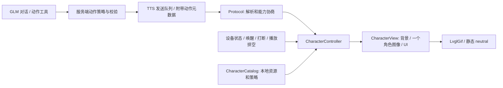

# CoreS3 佩奇角色显示技术设计

版本：v1，2026-09-17。状态：设计完成；第一、二阶段完成并经 CoreS3 真机验证；动作触发已打通端到端（语音"跳个舞"→GLM→设备动画），实现走**设备 MCP 工具**路线，对 §8 服务端工具路线的偏离见 §15。服务端零代码改动。

本轮产物包括素材原文件、统一画布资源包 `assets/character/peppa-v1/`（含浅蓝底逐帧预览与制作报告）、制作工具 `scripts/character_pack_tools/`、固件角色模块与 MCP 工具、本设计。已生成新固件（版本 2.5.1-peppa.1）并刷机验证。

## 1. 已确定的产品行为

- 320×240 屏幕使用统一浅蓝背景 `#DCEFF8`。
- 普通场景只有佩奇；音箱、麦克风、背包、泥坑等必要道具随动作保留。乔治等其他角色只出现在明确的互动动作中。
- neutral 是单人全身、闭嘴微笑、无道具的静态站立形象。第一版不强求待机眨眼、呼吸或口型同步。
- 动作由对话语义选择；设备状态决定倾听、等待、说话等即时反馈。
- 播放次数由程序策略决定，不依赖下载 GIF 的无限循环标记。
- 动作播放结束、被打断、失效或失败后恢复当前状态；基础角色始终为 neutral。
- 第一版不播放猪叫音效、不承诺真正唱歌；GIF 没有音轨。

## 2. neutral 素材决定

选用 Peppa Pig Wiki 角色页的站立图，社区来源，不标为官方发布。

- 来源：https://peppapig.fandom.com/wiki/Peppa_Pig_(character)
- 原图：https://static.wikia.nocookie.net/peppapig/images/6/61/Peppa_Pig.png/revision/latest?cb=20240627160159
- 本地：[peppa-neutral-source.webp](../tmp/peppa-media/neutral/peppa-neutral-source.webp)
- 元数据：[selected.json](../tmp/peppa-media/neutral/selected.json)
- 实际返回格式：WebP RGBA，1920×1920，85,060 字节；URL 中虽有 `.png`，文件内容不是 PNG。
- Alpha 范围 0～255；非透明包围盒为 `(271,51)-(1642,1867)`。已实际解码和查看，人物全身完整、无字幕、无道具、脚落地。
- SHA-256：`74976b45c85593e23276cf180f8e4d418978c21d3c538ae7e97737e8016fce85`。
- 原始边缘有少量灰色像素，后续缩小到设备尺寸时需核对浅蓝背景上的边缘。当前原图未抠图、重绘或改色。

官网角色页的图带白色装饰块，且人物为跳跃姿势，故不作 neutral。另三个下载候选的棋盘格实际属于图片像素，不是真透明，均不选。

第一版制作时将此原图转换为带 Alpha 的 LVGL 静态二进制图像，使用现有 `LvglCBinImage` 路径；不要求设备新增 WebP 解码器。neutral 常驻内存，以便动画切换失败时立即显示。

## 3. 素材清单与制作规范

原文件保留在 `tmp/peppa-media/`；这里是本地下载目录，不是最终固件资源路径。实现阶段才建立稳定的角色包源目录及打包输入，不能让构建依赖临时目录。

| 动作 ID | 原文件（相对素材目录） | 第一版策略 | 备注 |
|---|---|---|---|
| `neutral` | `neutral/peppa-neutral-source.webp` | 静态 | 唯一基础姿态与兜底 |
| `dance` | `round2/selected/dance.gif` | 播 2 遍，上限 6 秒 | 佩奇＋音箱；源循环约 2.36 秒 |
| `walk` | `round2/selected/travel.gif` | 播 2 遍，上限 4 秒 | 带背包，不能冒充纯站立招手；源循环约 1.2 秒 |
| `sing` | `round2/selected/singing.gif` | 回复期间循环，上限 8 秒 | 保留麦克风；只是动作，源循环约 3.54 秒 |
| `muddy_jump` | `round2/conditional/muddy-puddles-transparent.gif` | 播 2 遍，上限 4 秒 | 泥浆对身体的短暂覆盖属于动作；作为整体保留 |
| `play_with_george` | `round2/interaction/bedtime.gif` | 播 2 遍，上限 4 秒 | 双人跳床互动；源循环约 0.84 秒 |

`wave`、`oink`、独立 `sad`、`thinking`、`talking` 动画不进入 v1 对外可用动作列表。没有素材的状态使用 neutral 加文字/简单指示，不能拿任意其他动作代替。

官网 GIF 来源及哈希见 [第二轮清单](../tmp/peppa-media/round2/sources.json)。不得因为搜索标签合适而重新启用排除素材。

制作参数：

- 动画统一画布 256×168，置于中间舞台正中；保留透明通道。
- 普通单人角色的站立高度目标 128 像素，脚底基准为画布 `y=152`，人物躯干中线位于 `x=128`。
- 以角色大小确定缩放，不能按包含音箱、泥坑的整体包围盒自动缩放。一个动作的所有帧使用相同变换，保留跳跃位移。
- 双人及床等互动整体可以缩小到舞台内，记录该动作自己的变换，不能切掉头、脚或必要道具。
- 目标约 12～15 fps；按累计时长抽帧，不把原来的慢动作加快；延时按 GIF 的 10 ms 精度量化并控制总时长误差。
- 每个 GIF 使用稳定的调色板和透明色；需保留全局色表，因为当前 `gifdec` 要求它存在。优先不做易产生噪点的强抖动。
- 去除旅行贴纸白边时不得侵蚀眼白、手指或皮肤边缘。已完成：从紧邻透明像素的近白色向外泛洪置透明，逐帧检查无残留、眼白完好。
- 逐帧验证 GIF disposal、透明区域清除、边缘，以及循环接缝。复杂遮挡素材直接不选。

制作层可以分为背景、角色、道具和互动角色；运行时分为“静态背景＋一个合成透明角色动画＋UI”。泥浆盖住身体的素材不强行拆出不存在的干净身体像素。

## 4. 画面布局

| 区域 | 屏幕坐标 | 行为 |
|---|---|---|
| 状态栏 | y=0～23 | 网络、电量及必要状态 |
| 角色舞台 | y=24～191 | 浅蓝背景；256×168 角色画布从 x=32 开始 |
| 字幕区 | y=192～239 | 最多两行中文；不向上挤压角色舞台 |

浅蓝色由 UI 背景层绘制，不烘焙进所有 GIF。字幕过长时沿用裁切/更新策略，角色尺寸不随文本变化。系统弹窗、配网、升级和其他已有专用界面覆盖角色模式；退出时根据实际状态重新计算画面。

第一版使用固定浅蓝角色主题；亮度仍由设备调节，不自动切成另一种夜间背景。普通聊天 UI 保留为关闭角色模式时的回退路径。

## 5. 当前代码核对与差距

核对基于固件提交 `7ddaad75fd8c2ce3a1de997c6dbcedbb1a4876d8` 及本机服务端源码。

- `main/display/lcd_display.cc::SetEmotion` 已能按名字找到资源，并播放 GIF。每次调用都会销毁原 GIF 控制器，包括重复的同名情绪。
- `main/display/lvgl_display/gif/lvgl_gif.cc` 输出 `ARGB8888`，已有开始、暂停、停止、循环计数与帧回调；缺少业务可用的播放完成/错误事件。
- `gifdec.c` 从 GIF 读取循环数。`gd_rewind` 会重置循环计数；不能只设置一次策略便假定后续重播仍有效。
- `main/assets.cc` 已支持自定义表情资源和主题背景色。
- `main/application.cc` 会在待机、连接、倾听时设置 `neutral`，并在 `llm` 消息中取 `emotion`；这些入口会竞争显示，需要汇入一个控制器。
- 后端 `core/utils/textUtils.py::get_emotion` 从模型文本中取 emoji；没有 emoji 也发 `happy`。`connection.py` 每轮仅在开头提取一次，不能把这个 `happy` 当作“跳舞”。
- 后端 `sendAudioHandle.py` 有 `tts/start`、`sentence_start`、`stop`。内部 `sentence_id` 还用来判断当前生成轮次；不能假定它就是每句话的独立编号。现有线上消息未提供本文的视觉轮次字段。
- `AudioService` 有播放队列排空回调，但没有逐句播放位置回调。`tts/stop` 与扬声器真正播放完不是完全相同的时刻。

## 6. 架构与职责



- `CharacterCatalog`：持有经过验证的动作描述、资源生命周期和默认播放策略；佩奇相关文件、名称、映射在角色包中，不硬编码到通用 Application。
- `CharacterController`：唯一视觉决策者，接收轻量事件，处理状态、轮次、优先级、去重、计时、取消和回退。只在应用主任务修改其状态。
- `CharacterView`：LVGL 布局、静态 neutral、当前 GIF、字幕和提示。持有一个 GIF 解码器；所有 LVGL 对象变化受显示锁保护。
- `Application`：把现有状态/协议事件转给控制器，不引用具体 CoreS3 类或板级引脚。
- `Protocol`：统一可选能力和视觉消息语义，WebSocket、MQTT/UDP 共用契约。
- 服务端动作策略：校验设备和角色包支持的动作、绑定当前回复、不阻塞普通语音。

为支持无屏/OLED等目标，Display 的角色能力默认为“不支持”，新接口默认无操作。角色功能由可选 Kconfig 开关和资源包共同启用，不改变 CoreS3 板型、引脚或 OTA 身份。

## 7. 状态、情绪和动作分离

视觉基础状态不新增到 `DeviceState` 枚举，也不绕过 `Application::SetDeviceState()`：

| 视觉状态 | 输入依据 | 基础显示 |
|---|---|---|
| standby | 真正闲置 | neutral |
| connecting | 网络/音频通道建立 | neutral＋“连接中” |
| listening | 实际开始采集 | neutral＋“我在听” |
| waiting | 本次发言结束/进入处理，尚无回复语音 | neutral＋“想一想” |
| speaking | 回复开始，直到 stop 且本轮播放排空 | neutral＋说话指示；可叠加本轮具体动作 |
| system | 配网、升级、激活、故障、其他专用视图 | 原有系统界面 |

输入仍处于连续监听模式时，仅凭 VAD 短暂停顿不制造“正在思考”的状态；以应用能确认的提交/处理事件为准。

优先级：系统界面 > 用户打断/重新采集 > 当前轮特殊动作 > 基础状态。`emotion` 只是低优先级信息；v1 不把它映射成强动作。所有未映射情绪都留在 neutral。

普通回复不会让佩奇拿麦克风或跳舞；动作策略不得由默认 `happy` 自动触发。

## 8. 动作选择：模型提议，服务端和设备约束

v1 设计服务端工具 `request_character_action(action)`，允许 `dance`、`walk`、`sing`、`muddy_jump`、`play_with_george`，列表取设备能力与角色包的交集。

- 该工具只记录“本轮回复动作提议”，不立刻操作设备、不输出动作控制文字到 TTS，也不改变角色人设。
- 一个回复轮次只选择一个特殊动作，附在该轮第一句语音上。模型应先调用工具，再给自然语言回复。
- 多次工具调用只保留提交前的最后一个有效提议；第一句已经发送后到达的提议不追插，直接丢弃。后续版本才支持一句一个动作。
- 后端最终决定播放策略；模型不能填写本地路径、URL、任意时长、循环次数或优先级。
- 禁止仅凭关键词触发：明确动作请求才表演；“不要跳舞”“为什么喜欢泥坑”均不触发。角色扮演里的自发表演也必须与回复一致。
- 当前配置此前为 `nointent`，不能假定工具已启用。实现阶段需为该智能体选择并验证 `function_call` 路径；代码有工具调用入口，但本轮没有验证 GLM 当前模型/API 实际支持情况。
- 验证不通过时，采用有限的明确指令规则（跳个舞/去散步/跳泥坑/和乔治玩，含否定保护），其余保持 neutral。不得为了拿到动作而额外阻塞一次分类模型请求。
- 工具选择失败、超时、返回未知动作或无工具调用时，正常文字与语音仍继续。

这属于服务端对话工具，不是新增设备 MCP 远程控制 API。设备只接收经校验的可选视觉元数据。

## 9. 可选协议扩展 v1

以下 JSON 是拟定契约，当前程序尚未支持。字段均为附加项，旧设备/服务端应忽略；只有双方确认版本 1 才发送具体动作。

设备 hello 增加：

```json
{
  "features": {"character_animation": true},
  "character_animation": {
    "version": 1,
    "pack_id": "peppa-v1",
    "epoch": 1,
    "actions": ["neutral", "dance", "walk", "sing", "muddy_jump", "play_with_george"]
  }
}
```

服务端 hello 回应 `character_animation: {"version":1}` 表示确认。未确认时只用本地状态和 neutral，不发送或依赖动作扩展。

设备生成 `epoch`，在新的采集窗口和用户打断时递增。新的 `listen/start` 和 `abort` 附带 `character_animation: {"version":1,"epoch":N}`。若是连续监听中的本地 VAD 打断，没有新的 listen 消息，则发送同等作用的 `type:"character", state:"reset", version:1, epoch:N, session_id` 控制消息。由主任务按协议发送顺序提交，先发布新 epoch，再把该轮采集提交给服务端。

服务端在接收新输入时快照 epoch，生成任务不能在发送旧结果时读取并套用新 epoch。没有本地 VAD 的模式由服务端在确认新输入后终止旧轮视觉；不声称可以在设备尚未知道用户插话时提前取消。

每个服务端回复轮有通道内递增的 `turn_seq`。在该轮所有 TTS 的 start、sentence_start、stop 中附带同一上下文；`sentence_index` 独立从 0 增长，不能直接复用当前内部 `sentence_id`。

第一句消息示例：

```json
{
  "type": "tts",
  "state": "sentence_start",
  "session_id": "current-session",
  "text": "好呀，我们一起跳泥坑！",
  "character_animation": {
    "version": 1,
    "epoch": 7,
    "turn_seq": 12,
    "sentence_index": 0,
    "action": "muddy_jump",
    "playback": {"mode": "repeat", "plays": 2, "max_ms": 4000}
  }
}
```

start/stop 只需要上下文，不携带动作。普通回复仍携带上下文，但没有 action。首句以后不接受新的 action；重复首句用 `(session_id, epoch, turn_seq, sentence_index)` 去重。

播放字段：

- `mode=once`：总共一遍。
- `mode=repeat`：总共 `plays` 遍，允许 1～2；含首遍，不沿用 Netscape repeat 的歧义。
- `mode=reply`：循环到本轮回复结束，且受 `max_ms` 限制。
- `max_ms` 为开始显示后的单调时钟时限，允许 500～8000 ms；每个动作再限制到本地目录指定上限。
- mode 必须属于该动作允许的模式。字段类型、整数性、范围、动作枚举均验证；无效元数据整项忽略，仍显示字幕和播放语音。
- 标识字符串长度不超过 64，动作名不超过 32，actions 数组不超过 16；epoch、turn_seq、sentence_index 使用非负整数且按字段限制范围，不把浮点小数强制截断为合法值。
- 不接受网络资源 URL、文件路径、内嵌 GIF 数据，也不允许任意名称穿透到资源访问。

会话 identity 来自实际传输回调，不仅信任 JSON 中的 `session_id`。epoch 与本地一致，turn_seq 不旧于已确认轮次，且该轮未结束或取消，才接受动作。

## 10. 播放时机与生命周期

v1 为句子边界附近同步：动作消息随第一句 TTS 发送路径发出，设备收到该句后开始播放。现有音频预缓冲可能造成画面稍领先声音；本版本不增加音频包时间戳或逐样本同步协议，也不承诺精确口型。

1. TTS start 建立匹配 session/epoch/turn 的回复上下文；没有有效上下文则只走普通聊天显示。
2. 第一条有效 sentence_start 携带动作时，校验资源，设置播放策略，开始当前动画；若事件调度顺序导致 start 尚未处理，最多暂存一个动作、最长 1 秒，超时丢弃。
3. 重复事件不重播。同一状态重复到来不重建 GIF。特殊动作不形成队列。
4. 次数耗尽或最长时限达到，销毁当前解码器并显示 neutral，加上当前基础状态指示。
5. 本轮结束必须同时满足有效 TTS stop 已到达且音频播放队列排空。流式传输中暂时空队列不是回复结束。stop 已到时应立即查询 IsPlaybackIdle，覆盖“排空回调先到”的情况。
6. 所有动作都在本轮真正结束时停止，即使两遍还没播完；不会为了补全表演而阻止设备进入倾听。
7. 用户打断、新采集窗口、断线、系统界面抢占时立即取消，并推进视觉 generation。旧计时器/完成回调必须带 generation，不能把新动画错误地恢复到 neutral。
8. 原有 DeviceState 可能在音频尾部排空之前先转 Listening；视觉状态要区分“即将监听”和“实际采集已开始”，避免剩余语音还在播而画面已经跳回。

控制器只维护一个活动动作和一个短期候选。没有动作依赖后端无限期持续发新情绪才能结束。

## 11. GIF 播放器改动设计

- 增加播放完成与解码失败事件，语义是本次播放实例完成，而不是每帧通知。
- 明确“完成一个循环”的事件并统一由 PlayPolicy 计数；资源内循环标记只作格式信息，不能覆盖应用策略。
- 每次 rewind 后重新应用本次策略；完成只通知一次。
- `gd_get_frame` 返回负数时必须停止并报错，不能当作正常帧继续处理。
- 停止、切换资源、主题/资源包更新前，在显示锁内解除 LVGL 对旧画布的引用，再释放解码器和旧资源所有者。
- LVGL timer 回调不直接改变 Application 状态：投递小事件，由主任务消费，避免显示锁与主任务锁互相等待。
- 资源加载失败显示常驻 neutral；连 neutral 资源都无效时退回内置表情和原系统 UI，并禁用能力声明。

## 12. 资源包、内存和构建

在现有 assets 索引中增加可选 `character_pack`，与原 `emoji_collection` 并存。字段包括 version、pack_id、background、canvas、neutral、actions。每个动作记录运行文件名、格式、画布尺寸、单循环时长、默认策略、允许模式和回退名。

资源包元数据中的锚点/缩放在制作阶段烘焙到透明画布；运行时使用固定舞台位置，不对每帧重新算包围盒。图像源由 Assets 的现有映射持有，播放期间不能释放/替换。

- 静态 neutral 转为匹配项目 LVGL 版本的 Alpha CBin；GIF 通过现有解码器加载。
- 打包前验证所有文件存在、真实格式、完整解码、尺寸、全局色表、时长和引用关系；明确设定主版本不兼容时忽略角色包。
- 运行时也要限制尺寸、数量和长度，验证 GIF 数据边界；当前仅传入数据指针的解码接口不能被当成通用不可信文件解析器，需引入长度约束或等价的完整资源预检。
- 当前 GIF 基础分配约 `5×width×height`，256×168 对应 215,040 字节，另有结构体、LZW 表及配置相关缓存。不能只按 GIF 文件大小估算 RAM。
- 同时只有一个解码器；额外内存目标不超过 768 KiB（含常驻 neutral 与切换峰值），以真机 heap/PSRAM 测量为准。目标不是已测结果。
- 新角色运行素材目标总量 ≤2 MiB，打包后 assets 分区至少预留 512 KiB。现有待刷的“你好佩奇”包记录为 5,067,308 字节，assets 分区 8,388,608 字节；这些是已有构建记录，不是本轮重新读取设备的结果。
- 新包必须保留中文字体和 MultiNet 唤醒模型/配置；不能通过覆盖分区或 NVS 牺牲已部署语音配置。
- SDK 按本会话指令优先 ESP-IDF 6.1，最低 6.0.1。通过 canonical build 和配置入口启用，不手改 sdkconfig、build、vendor 或生成头文件。

第一版功能需要固件与服务端升级，不能仅换 GIF 获得完整播放策略。以后同版本角色包更新才可单独更换资源。备份、分区校验、回滚和刷机属于实现/部署阶段，本轮不执行。

## 13. 预计文件范围（全部为计划）

| 位置 | 职责 |
|---|---|
| 新增 `main/display/character/` | Catalog、Controller、View、消息校验类型；通用、不写板级引脚 |
| `main/display/display.h` 与 `lcd_display.*` | 可选能力、角色布局及统一的显示入口 |
| `main/display/lvgl_display/gif/lvgl_gif.*`、必要时 `gifdec.*` | 明确播放策略、完整结束/错误事件、边界验证 |
| `main/application.*` | 现有状态、轮次、打断、播放排空事件桥接 |
| `main/protocols/protocol.*`、两种 transport | 能力协商及 epoch 扩展，保持语义一致 |
| `main/assets.*`、资源打包脚本 | 可选角色包，保留原索引兼容 |
| Kconfig/CMake、CoreS3 构建配置 | 功能开关与依赖限制，保持板型身份 |
| 服务端 `plugins_func/functions/` | 动作提议工具；不直接异步发任意显示消息 |
| 服务端 connection/TTS DTO/sendAudioHandle | 轮次绑定、不可变 epoch、第一句动作与取消校验 |
| 服务端 hello/listen/abort 路径 | 协商和 epoch 更新 |
| 协议文档和主机测试 | JSON 契约、兼容性、状态机和资源测试 |

不改动聊天人设正文、模型密钥、板级工厂、引脚或已有独立功能。具体配置启用仅针对佩奇智能体与 CoreS3 角色模式。

## 14. 验收与实现顺序

第一阶段：把 neutral 和选定动作制作到统一画布，提供浅蓝底本地预览；逐帧检查头脚完整、人物比例、循环接缝和 Alpha 残影。产出资源包和尺寸/容量报告。

第二阶段：仅在设备侧接入角色视图与受控播放，先用本地调试事件验证一次、两次、回复循环和打断；中断必须同时取消 timer、候选和过期完成事件。

第三阶段：接入可选协议及服务端工具。验证 GLM 工具调用支持；若不支持，按已定义规则降级，不改变普通聊天可用性。

第四阶段：在 CoreS3 真机测试语音与显示并发，达到以下验收条件后才部署：

| 场景 | 预期 |
|---|---|
| 普通问候/问日期，无动作提议 | neutral＋状态指示，不因默认 happy 跳舞 |
| “跳个舞” | 对应回复首句触发，至多两遍/6秒，回复结束可提前停止 |
| “不要跳舞”“为什么喜欢跳泥坑” | 不因关键词触发表演 |
| “和乔治一起玩” | 允许双人素材，其余动作不得混入其他角色 |
| 重复首句、重复 emotion、重复本地状态 | 动画不反复从头开始 |
| 打断后迟到旧 start/action/stop | 不重新启动旧动画，不清掉新动画 |
| 音频短时断流、stop 先到/排空先到 | 不把临时空队列当作结束；最终正确回到基础状态 |
| GIF 损坏、无资源、未知 ID/版本、过大尺寸 | 保持语音，回退 neutral/内置 UI，不崩溃 |
| 断线重连、资源更新、配网/升级/专用视图切换 | 清理旧生命周期，恢复时根据实际状态重算 |
| 音频与 GIF 并发 30 分钟、反复切换动作 | 无持续内存下降、无新增可闻卡顿；记录内存与解码耗时 |
| 旧服务端/旧设备、无屏、OLED、普通 LVGL | 保持原功能；无协商则只用本地 neutral，不依赖新字段 |

实现阶段运行主机测试、代表性 LVGL/无屏/OLED 构建及 WebSocket/MQTT-UDP 契约检查；音频回归包含采集、播放、唤醒、VAD、打断、重连和实际启用的 AEC 模式。成功构建不等于硬件验证。

## 15. 当前完成与边界

已完成：素材搜索与下载、neutral 原图视觉和 Alpha 检查、既有代码接口核对、本设计文档、第一阶段素材加工——neutral 与五个动作已统一到 256×168 画布并产出 `assets/character/peppa-v1/` 资源包（浅蓝底逐帧预览、pack.json 清单、尺寸/容量报告、raw 素材哈希，制作工具在 `scripts/character_pack_tools/`）。资源包所有 GIF 经结构校验、按 gifdec 语义的主机解码回读与 Pillow 解码三方验证；muddy_jump 与 play_with_george 因泥点飞溅跨满源画布、双人+床为互动整体，按"整体缩小到舞台内并记录各自变换"处理（缩放 0.525 / 0.375），未套用 128 px 站立高。

第二阶段：`main/display/character/`（Catalog/Controller/View）、LvglGif 播放策略与完成事件、Assets 可选 character_pack 索引、Display 可选能力、neutral 转 LVGL ARGB8888 BIN，真机修复（GIF disposal=2、MCP 回调空指针、贴纸白边去保护皮肤、动作文件扁平化入 assets）。

第三阶段（实现期偏离记录）：动作触发的最终实现走**设备 MCP 工具** `self.character.play_action`（GLM 经既有 function_call+MCP 通道调用），服务端零代码改动——这是对 §8 服务端工具路线的替代：无需改 xiaozhi-server 仓库，代价是没有服务端策略校验与 §9 的 epoch/第一句绑定（§9 协议扩展代码已写入固件并随 hello 上报，处于休眠态，服务端路线若将来落地可直接启用）。前置条件是管理端把智能体意图模块设为 function_call（nointent 下 LLM 看不到任何工具）。真机 E2E 已验证：语音"跳个舞"→ GLM 调用工具 → 设备返回 true → 佩奇跳舞。

尚未执行：§14 第四阶段完整验收（30 分钟音频+GIF 并发压测、打断场景矩阵、无屏/OLED 代表性构建）、天气/新闻等插件在 glm-4-flash 下的工具调用意愿优化、PR 与部署。

设计已给出缺素材、无模型工具支持、协议不兼容及加载失败时的确定回退，不以这些外部条件作为普通中文聊天的前置依赖。
